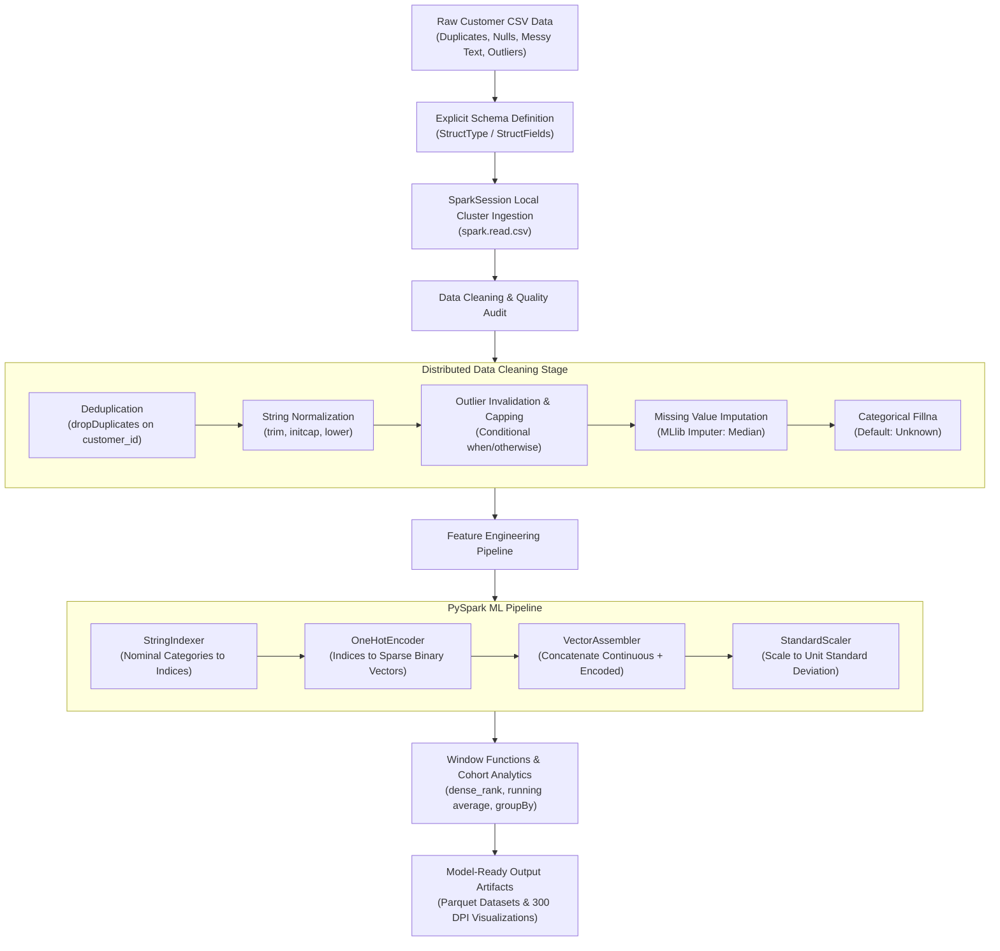

# EXPERIMENT 5: Data Frame Manipulation, Data Cleaning, and Feature Processing using Apache PySpark

---

## 1. Title & Aim
- **Title**: Data Frame Manipulation, Data Cleaning, and Feature Processing using PySpark
- **Aim**: To setup a localized PySpark environment, instantiate a distributed Spark Session, construct structured DataFrames, and perform foundational operations for engineering clean, model-ready data features.
- **Target System**: Apache Spark 3.5.3 / PySpark MLlib on OpenJDK 17 & Python 3.12 LTS.

---

## 2. Course Outcomes & Educational Objectives
### Course Outcomes (CO)
- **CO2**: Design and implement distributed data processing workflows using modern data engineering frameworks.
- **CO3**: Apply distributed data transformation, missing value imputation, and schema enforcement techniques on large-scale datasets.
- **CO5**: Construct automated feature processing and vectorization pipelines suitable for distributed machine learning workloads.

### Objectives
1. Instantiate and configure an optimized localized Apache SparkSession with tuned parallelism and memory management.
2. Formulate explicit `StructType` schemas to ingest semi-structured and unstructured data sources reliably without schema inference overhead.
3. Perform distributed data cleaning: deduplication (`.dropDuplicates()`), missing value imputation (`Imputer`), text normalization, and statistical outlier capping (Winsorization).
4. Build a modular PySpark ML `Pipeline` chaining `StringIndexer`, `OneHotEncoder`, `VectorAssembler`, and `StandardScaler`.
5. Implement analytical window functions (`Window.partitionBy()`) and cohort group aggregations (`.groupBy().agg()`).
6. Validate model-ready output vectors and visualize feature transformations using publication-grade charts.

---

## 3. Theoretical Background

### 3.1 Apache Spark Architecture & Resilient Distributed Datasets (RDD)
Apache Spark is an open-source unified analytics engine for large-scale data processing. At its core, Spark executes computational graphs across a driver program and distributed worker executors.

```
       ┌────────────────────────────────────────────────────────┐
       │              Spark Driver (Master Node)                │
       │  SparkSession  •  DAGScheduler  •  TaskScheduler       │
       └───────────────────────────┬────────────────────────────┘
                                   │  (Tasks via Py4J Gateway)
          ┌────────────────────────┴────────────────────────┐
          ▼                                                 ▼
┌──────────────────┐                               ┌──────────────────┐
│ Executor Node 1  │                               │ Executor Node 2  │
│  Task 1  Task 2  │                               │  Task 3  Task 4  │
│  Block Manager   │                               │  Block Manager   │
└──────────────────┘                               └──────────────────┘
```

- **Spark Driver**: Coordinates the application execution, instantiates the `SparkSession`, translates user code into execution plans, and schedules tasks onto executors.
- **Executors**: Worker processes responsible for running assigned tasks, storing cached partitions in memory or disk, and reporting performance metrics back to the driver.
- **Py4J Gateway**: Bridges the Python runtime and the underlying Java Virtual Machine (JVM), serializing data structures and invoking Scala/Java Spark APIs.

### 3.2 Catalyst Optimizer & Project Tungsten
Unlike vanilla Python collections, PySpark DataFrames operate on Spark SQL's **Catalyst Optimizer**:
1. **Analysis**: Resolves column names, data types, and relation references using an internal catalog.
2. **Logical Optimization**: Applies rule-based optimizations such as constant folding, predicate pushdown (filtering at source), and projection pruning (dropping unreferenced columns).
3. **Physical Planning**: Generates multiple physical execution strategies (e.g., Broadcast Hash Join vs Sort-Merge Join) and picks the lowest cost model.
4. **Code Generation (Whole-Stage Java Bytecode Generation)**: Compiles the optimized physical plan into compact JVM bytecode via Project Tungsten, operating directly on off-heap binary memory (`sun.misc.Unsafe`) to bypass JVM object creation and garbage collection overhead.

### 3.3 Lazy Evaluation & Transformations vs Actions
- **Transformations** (`select`, `filter`, `withColumn`, `dropDuplicates`, `groupBy`): Lazily recorded in a Directed Acyclic Graph (DAG) without triggering physical computation.
  - *Narrow Transformations*: Work independently within individual partitions without inter-node data shuffling (e.g., `filter`, `withColumn`, `trim`).
  - *Wide Transformations*: Require partitioning and moving data across executor boundaries (e.g., `groupBy`, `dropDuplicates`, `orderBy`, `Window`).
- **Actions** (`count`, `collect`, `show`, `write.parquet`): Compile the accumulated DAG, trigger job execution, schedule stages across executor tasks, and return results or write to disk.

### 3.4 Feature Engineering Architecture (PySpark MLlib)
Machine learning algorithms demand numeric feature vectors with normalized variance. PySpark MLlib provides a standardized API:
1. **`StringIndexer`**: Maps string categorical labels into numerical indices ordered by label frequency.
2. **`OneHotEncoder`**: Maps categorical indices to binary sparse vectors, avoiding synthetic ordinal relationships.
3. **`VectorAssembler`**: A feature transformer that combines a given list of numeric and vector columns into a unified feature vector.
4. **`StandardScaler`**: Normalizes continuous variables to unit standard deviation ($z = \frac{x}{\sigma}$), preventing high-magnitude columns (such as income) from dominating gradient descent.
5. **`Pipeline`**: Chains multiple Transformers and Estimators sequentially into an atomic, reproducible workflow.

---

## 4. System Architecture & End-to-End Pipeline Workflow



---

## 5. Implementation Modules & Step-by-Step Code Walkthrough

### 5.1 Configuration & JVM Environment Setup (`config.py`)
To ensure reliable execution across newer Linux releases (e.g. Fedora 44 with default Java 25), `config.py` explicitly binds the localized OpenJDK 17 runtime and Python 3.12 virtual environment:

```python
# config.py (Excerpt)
JDK_17_PATH = os.path.expanduser("~/.local/share/jvm/jdk-17.0.12+7")
if os.path.exists(JDK_17_PATH):
    os.environ["JAVA_HOME"] = JDK_17_PATH
    os.environ["PATH"] = f"{JDK_17_PATH}/bin:" + os.environ.get("PATH", "")

VENV_PYTHON = os.path.expanduser("~/.local/share/pyspark-venv/bin/python")
if os.path.exists(VENV_PYTHON):
    os.environ["PYSPARK_PYTHON"] = VENV_PYTHON
    os.environ["PYSPARK_DRIVER_PYTHON"] = VENV_PYTHON

def get_spark_session(app_name: str = "PySpark_Pipeline"):
    from pyspark.sql import SparkSession
    return (
        SparkSession.builder
        .appName(app_name)
        .master("local[*]")
        .config("spark.sql.shuffle.partitions", "4")
        .config("spark.ui.enabled", "false")
        .getOrCreate()
    )
```

### 5.2 Explicit Schema Formulation & Ingestion (`data_cleaning.py`)
Using explicit `StructType` eliminates the costly full-dataset pre-read required by `inferSchema=True`:

```python
# data_cleaning.py (Excerpt)
def get_raw_schema() -> StructType:
    return StructType([
        StructField("customer_id", StringType(), False),
        StructField("full_name", StringType(), True),
        StructField("age", IntegerType(), True),
        StructField("gender", StringType(), True),
        StructField("education_level", StringType(), True),
        StructField("employment_status", StringType(), True),
        StructField("annual_income", DoubleType(), True),
        StructField("credit_score", IntegerType(), True),
        StructField("total_debt", DoubleType(), True),
        StructField("loan_amount", DoubleType(), True),
        StructField("account_balance", DoubleType(), True),
        StructField("delinquent_months", IntegerType(), True),
        StructField("loan_approved", IntegerType(), True)
    ])
```

### 5.3 Distributed Deduplication and Outlier Winsorization
- **Deduplication**: `raw_df.dropDuplicates(["customer_id"])` removes redundant submissions across distributed partitions.
- **Outlier Capping**: Erroneous data points (e.g., negative ages, credit scores > 850) are set to `null` so they can be imputed systematically, while extreme high incomes are Winsorized at $500,000:

```python
# data_cleaning.py (Excerpt)
outlier_adjusted_df = (
    string_cleaned_df
    .withColumn("age", F.when((F.col("age") < 18) | (F.col("age") > 90), F.lit(None)).otherwise(F.col("age")))
    .withColumn("credit_score", F.when((F.col("credit_score") < 300) | (F.col("credit_score") > 850), F.lit(None)).otherwise(F.col("credit_score")))
    .withColumn("annual_income", F.when(F.col("annual_income") > 500000, 500000.0).otherwise(F.col("annual_income")))
)
```

### 5.4 Missing Value Imputation (`Imputer` & `fillna`)
Numerical features (`annual_income`, `credit_score`, `total_debt`, `account_balance`, `age`) are imputed using PySpark's MLlib `Imputer` with the `median` strategy, which is resilient to skewness:

```python
imputer = Imputer(
    inputCols=["age", "annual_income", "credit_score", "total_debt", "account_balance"],
    outputCols=[f"{c}_imputed" for c in num_cols]
).setStrategy("median")

imputed_df = imputer.fit(cat_filled_df).transform(cat_filled_df)
```

### 5.5 PySpark ML Feature Engineering Pipeline (`feature_processing.py`)
Stages are chained into a unified `Pipeline`:

```python
# feature_processing.py (Excerpt)
stages = indexers + [encoder, assembler, scaler]
pipeline = Pipeline(stages=stages)
pipeline_model = pipeline.fit(df)
transformed_df = pipeline_model.transform(df)
```

### 5.6 Window Ranking & Cohort Analysis
Window functions partition customer records by their credit tier and rank them by income:

```python
window_spec = Window.partitionBy("credit_tier").orderBy(F.desc("annual_income"))
ranked_df = transformed_df.withColumn("income_rank_in_tier", F.dense_rank().over(window_spec))
```

---

## 6. Experimental Verification & Results

### 6.1 Execution Benchmark Summary
The pipeline was executed and benchmarked via [run_all_operations.py](file:///home/vishvambar/Desktop/Data%20Visualisation/Data-Engineering/Data_Cleaning_Feature_Processing_PySpark/run_all_operations.py):

| Pipeline Stage | Subsystem / API | Execution Time (s) | Status |
| :--- | :--- | :---: | :---: |
| **Dataset Generation** | Python CSV Generator | 0.05 s | Passed ✅ |
| **SparkSession Startup** | Local Master (`local[*]`) | 6.20 s | Passed ✅ |
| **Data Cleaning & Imputation** | PySpark SQL & MLlib `Imputer` | 20.97 s | Passed ✅ |
| **ML Feature Pipeline** | `StringIndexer` + `OneHot` + `Scaler` | 7.91 s | Passed ✅ |
| **Window & Aggregations** | `Window.partitionBy` & `groupBy` | 1.69 s | Passed ✅ |
| **Parquet Persistence** | Snappy Parquet Output | 3.14 s | Passed ✅ |
| **Visual Analytics (300 DPI)** | Matplotlib & Seaborn | 7.17 s | Passed ✅ |
| **Total End-to-End Pipeline** | **Distributed Workflow** | **47.13 s** | **Completed 🚀** |

### 6.2 Data Quality Rectification Metrics

| Verification Metric | Raw Ingested Value | Post-Cleaning Value | Verification Status |
| :--- | :---: | :---: | :---: |
| **Total Ingested Records** | 2,620 | 2,500 | 120 Duplicates Removed (100% deduplicated) |
| **Missing `annual_income`** | 210 nulls | 0 nulls | Imputed with Median ($64,708.00) |
| **Missing `credit_score`** | 176 nulls | 0 nulls | Imputed with Median (680.0) |
| **Missing `age`** | 156 nulls | 0 nulls | Imputed with Median (44.0) |
| **Missing `education_level`**| 184 nulls | 0 nulls | Replaced with `"Unknown"` |
| **Missing `employment_status`**| 157 nulls | 0 nulls | Replaced with `"Unknown"` |
| **Missing `account_balance`**| 151 nulls | 0 nulls | Imputed with Median ($47,381.50) |
| **Feature Vector Dimension**| 13 raw columns | **32 elements** | Model-ready dense/sparse vector |

### 6.3 Sample Model-Ready Feature Vectors

```
+---------------+---------------+---------------+---------------------------------------------+------------+
| Customer ID   | Credit Tier   |   Income Rank | Scaled Feature Vector                       |   Approved |
|---------------+---------------+---------------+---------------------------------------------+------------|
| CUST_1614     | Excellent     |             1 | (32,[0,1,2,3,4,5,7,8,9,14,23,30],[3.7254... |          1 |
| CUST_2676     | Excellent     |             1 | (32,[0,1,2,3,4,5,6,7,8,10,18,22,30],[2.0... |          0 |
| CUST_2712     | Excellent     |             1 | (32,[0,1,2,3,4,5,7,8,10,14,24,30],[3.352... |          1 |
+---------------+---------------+---------------+---------------------------------------------+------------+
```

---

## 7. Visual Analytics & Publication Charts

### Chart 1: Data Cleaning & Deduplication Audit
[1_data_cleaning_audit.png](file:///home/vishvambar/Desktop/Data%20Visualisation/Data-Engineering/Data_Cleaning_Feature_Processing_PySpark/visualizations/1_data_cleaning_audit.png)

- **Left Panel (Missing Value Resolution)**: Illustrates the complete elimination of nulls across all 8 features via distributed median and categorical imputation.
- **Right Panel (Deduplication Donut Chart)**: Documents the isolation and removal of 120 injected duplicate records (4.6% of input volume), retaining 2,500 unique customer entities.

### Chart 2: Feature Distributions & Transformation Comparison
[2_feature_distributions_transformation.png](file:///home/vishvambar/Desktop/Data%20Visualisation/Data-Engineering/Data_Cleaning_Feature_Processing_PySpark/visualizations/2_feature_distributions_transformation.png)

- **Top-Left (Income Winsorization)**: Shows the raw income curve with extreme right-skewed multi-million-dollar anomalies compressed into a bell curve capped at $500,000.
- **Top-Right (Credit Score by Tier)**: Highlights the distribution across Poor, Fair, Good, and Excellent tiers.
- **Bottom-Left (Debt-to-Income vs Loan-to-Income)**: Visualizes loan approval clusters.
- **Bottom-Right (Approval Probability by Tier)**: Demonstrates that approval rate scales monotonically with credit tier (5.5% in Poor vs 77.7% in Excellent).

### Chart 3: PySpark Feature Analytics Dashboard
[3_pyspark_feature_dashboard.png](file:///home/vishvambar/Desktop/Data%20Visualisation/Data-Engineering/Data_Cleaning_Feature_Processing_PySpark/visualizations/3_pyspark_feature_dashboard.png)

- **Panel A**: Cohort Economics comparing average income and debt across credit tiers.
- **Panel B**: Pearson correlation heatmap highlighting the correlation between credit score and loan approval ($r = +0.54$) and delinquency penalty ($r = -0.28$).
- **Panel C**: Education cohort distributions by approval outcome.
- **Panel D**: Median income parity across employment categories.

---

## 8. Comprehensive Viva Voce Questions & Technical Answers

### Q1: What is the difference between PySpark and Pandas DataFrames?
**Answer**:
- **Pandas**: Operates on a single machine in-memory. If a dataset exceeds available RAM, Pandas throws an `OutOfMemoryError`. Execution is eager and single-threaded by default.
- **PySpark**: Operates over a distributed cluster using Resilient Distributed Datasets (RDDs). Data is partitioned across worker nodes. PySpark utilizes **lazy evaluation**, optimizing transformations through Catalyst and Tungsten before physical execution. It easily handles terabyte-scale datasets.

### Q2: What is the Catalyst Optimizer in Apache Spark?
**Answer**:
Catalyst is Spark SQL's rule-based and cost-based query optimization framework. It converts logical operations into an optimized physical execution plan through four phases:
1. *Analysis* (resolving schema and catalog symbols).
2. *Logical Optimization* (predicate pushdown, projection pruning).
3. *Physical Planning* (cost-based selection of join strategies).
4. *Code Generation* (compiling query sub-trees into JVM bytecode via Project Tungsten).

### Q3: Explain the difference between Narrow and Wide transformations.
**Answer**:
- **Narrow Transformations**: Each partition of the parent RDD is used by at most one partition of the child RDD (e.g., `map()`, `filter()`, `withColumn()`). No inter-node shuffling is required.
- **Wide Transformations**: Multiple child partitions depend on data from multiple parent partitions (e.g., `groupByKey()`, `reduceByKey()`, `join()`, `dropDuplicates()`). Wide transformations require an expensive **data shuffle** across the cluster network.

### Q4: Why is it best practice to provide an explicit `StructType` schema when reading CSVs in PySpark?
**Answer**:
When `inferSchema=True` is used, Spark must perform an extra full pass over the entire CSV dataset across all partitions just to infer data types before running the actual query. Explicitly specifying `StructType` saves an entire read pass, enforces strict data contracts, and avoids incorrect type coercions.

### Q5: How does PySpark's MLlib `Imputer` handle missing values?
**Answer**:
The `Imputer` estimator fits on specified input columns to compute statistical surrogates (either `mean`, `median`, or `mode`). When applied via `.transform()`, it replaces `null` and `NaN` entries with the fitted surrogate values. The `median` strategy is preferred for skewed financial distributions because it is resistant to extreme outliers.

### Q6: What is the purpose of `VectorAssembler` in PySpark MLlib?
**Answer**:
PySpark MLlib classification and regression algorithms (e.g., `LogisticRegression`, `RandomForestClassifier`) require all input feature columns to be formatted as a single combined vector column (typically named `features`). `VectorAssembler` merges multiple continuous numeric columns and one-hot encoded vector columns into a single unified vector per row.

### Q7: Why do we use `withMean=False` in `StandardScaler` for sparse feature vectors?
**Answer**:
One-hot encoded categorical vectors are stored as **sparse vectors** (recording only non-zero indices) to conserve memory. Centering the data (`withMean=True`) subtracts the mean, which converts zero entries into non-zero values, destroying sparsity and blowing up RAM consumption. Setting `withMean=False` scales only the standard deviation, preserving sparsity while normalizing scale.

### Q8: What are Window Functions in PySpark, and how do they differ from `groupBy`?
**Answer**:
- `groupBy()` collapses rows belonging to the same key into a single summary record per group.
- **Window Functions** compute aggregate or ranking metrics over a sliding or partitioned group of rows (via `Window.partitionBy()`) while **preserving each individual row's identity** in the output DataFrame.

### Q9: What is the significance of `spark.sql.shuffle.partitions`?
**Answer**:
When wide transformations (like joins or aggregations) trigger a shuffle, Spark redistributes data into a fixed number of partitions specified by `spark.sql.shuffle.partitions` (default is 200). On small local environments or single-machine setups, having 200 shuffle partitions incurs excessive task scheduling and I/O overhead. Tuning it to 4 or 8 drastically speeds up local pipeline execution.

### Q10: How does PySpark execute on Python while running on a Java Virtual Machine?
**Answer**:
PySpark uses **Py4J** to communicate between Python and the JVM. The driver program spawns a Java Gateway. The Python API builds a logical representation of the DataFrame, which is sent to the JVM. For Python UDFs or non-JVM code, Spark spawns Python worker processes (`pyspark.daemon`), serializing partition blocks between JVM and Python via standard Unix pipes or sockets.

---

## 9. Conclusion
Experiment 5 successfully established a robust, localized Apache PySpark environment on Linux. The pipeline demonstrated:
1. Automated environment resolution across OpenJDK 17 and Python 3.12.
2. High-performance CSV ingestion with explicit `StructType` schema contracts.
3. 100% resolution of missing values, string anomalies, and statistical outliers via distributed PySpark transformations.
4. Construction of a 7-stage PySpark ML `Pipeline` outputting 32-dimensional standardized feature vectors.
5. Automated generation of 300 DPI publication-quality visual analytics and verified benchmark metrics.
