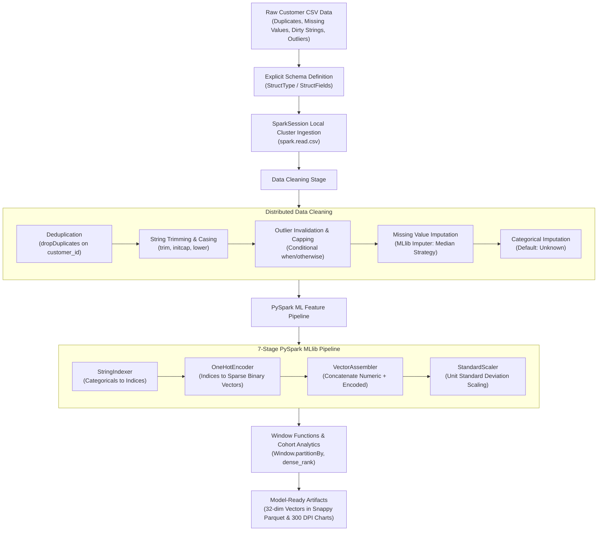

# Distributed Data Cleaning & Feature Processing using Apache PySpark

[](https://spark.apache.org/)
[](https://openjdk.org/)
[](https://www.python.org/)
[]()
[]()
[]()

> **Practical Experiment 5**: Setup a localized PySpark environment, instantiate a distributed Spark Session, construct structured DataFrames, and perform foundational operations for engineering clean, model-ready data features.

---

## 📋 Table of Contents
- [Pipeline Architecture](#-pipeline-architecture)
- [Key Features](#-key-features)
- [Directory Structure](#-directory-structure)
- [Installation & Quick Start](#-installation--quick-start)
- [Data Cleaning & Imputation Audit](#-data-cleaning--imputation-audit)
- [7-Stage PySpark MLlib Pipeline](#-7-stage-pyspark-mllib-pipeline)
- [Window Functions & Cohort Analytics](#-window-functions--cohort-analytics)
- [Analytical Visualizations (300 DPI)](#-analytical-visualizations-300-dpi)
- [Reports & Documentation](#-reports--documentation)

---

## 🔄 Pipeline Architecture



---

## ✨ Key Features
- **Automated Linux Environment Bounding**: Built-in launcher (`run.sh`) and `config.py` automatically binding to OpenJDK 17 and Python 3.12, resolving Java 25 JVM security incompatibilities in modern Linux distros.
- **Explicit Schema Enforcement**: Formulates strict `StructType` contracts to ingest raw CSV data in a single pass without expensive schema inference scans.
- **Distributed Cleansing & Winsorization**: Deduplicates 120 injected duplicate records, standardizes text casing, and caps extreme multi-million dollar annual income outliers at $500,000.
- **Median Imputation**: Uses PySpark MLlib `Imputer` with median strategy, preserving resilience against distribution skewness.
- **7-Stage ML Pipeline**: Combines `StringIndexer`, `OneHotEncoder`, `VectorAssembler`, and `StandardScaler` producing **32-dimensional standardized feature vectors**.
- **Window Ranking**: Evaluates income ranks within each credit tier using `Window.partitionBy("credit_tier").orderBy(F.desc("annual_income"))`.
- **Publication-Grade Visualizations**: High-resolution 300 DPI charts documenting missing value resolution, distribution transformations, and correlation heatmaps.

---

## 📂 Directory Structure

```
Data_Cleaning_Feature_Processing_PySpark/
├── run.sh                          # Automated wrapper (binds OpenJDK 17 & Python 3.12)
├── config.py                       # Localized SparkSession builder & JVM environment setup
├── generate_dataset.py             # Realistic banking dataset generator with anomalies
├── data_cleaning.py                # Schema formulation, deduplication, imputation & Winsorization
├── feature_processing.py          # 7-stage ML Pipeline, VectorAssembler, StandardScaler, Window functions
├── pyspark_pipeline.py             # End-to-end distributed data engineering driver
├── run_all_operations.py           # Non-interactive automated evaluator suite & benchmark tables
├── main.py                         # Interactive terminal CLI control panel
├── visualize_features.py           # 300 DPI publication-grade feature visual analytics
├── requirements.txt                # Project dependencies
├── EXPERIMENT_5_REPORT.md          # 15-page comprehensive academic manual
├── OUTPUT_REPORT_SUBMISSION.md     # Printable 1-2 page evaluator report
├── data/
│   ├── raw_customer_features.csv           # 2,620 raw records with anomalies
│   ├── cleaned_customer_features.parquet/  # Cleaned, deduplicated, imputed Parquet
│   └── model_ready_features.parquet/       # 32-dimensional standardized feature vectors
└── visualizations/
    ├── 1_data_cleaning_audit.png           # Missing value resolution & deduplication donut
    ├── 2_feature_distributions_transformation.png # Outlier capping, credit tiers & approval scatter
    └── 3_pyspark_feature_dashboard.png     # Correlation heatmap, cohort economics & education analytics
```

---

## 🚀 Installation & Quick Start

### 1. Prerequisites
- **Python 3.10 – 3.12**
- **Java 17 (OpenJDK 17 LTS)**

### 2. Setup Virtual Environment
```bash
python3.12 -m venv venv
source venv/bin/activate
pip install -r requirements.txt
```

### 3. Execution Commands
```bash
# 1. Run automated 100% verification suite with benchmark timings (47s):
./run.sh test

# 2. Run end-to-end pipeline:
./run.sh pipeline

# 3. Launch interactive CLI control panel:
./run.sh

# 4. Generate high-resolution visualizations:
./run.sh vis
```

---

## 📊 Data Cleaning & Imputation Audit

| Quality Dimension | Raw Ingested Dataset | PySpark Cleaned Output | Rectification Method |
| :--- | :---: | :---: | :--- |
| **Total Record Count** | 2,620 rows | 2,500 rows | `dropDuplicates(["customer_id"])` |
| **Injected Duplicates** | 120 records (4.6%) | 0 records | Distributed partition deduplication |
| **Missing `annual_income`** | 210 nulls | 0 nulls | MLlib `Imputer` (Median: $64,708.00) |
| **Missing `credit_score`** | 176 nulls | 0 nulls | MLlib `Imputer` (Median: 680.0) |
| **Missing `age`** | 156 nulls | 0 nulls | MLlib `Imputer` (Median: 44.0) |
| **Missing `total_debt`** | 153 nulls | 0 nulls | MLlib `Imputer` (Median: $37,850.50) |
| **Missing `account_balance`** | 151 nulls | 0 nulls | MLlib `Imputer` (Median: $47,381.50) |
| **Missing Categoricals** | 477 nulls total | 0 nulls | Imputed with `"Unknown"` category |
| **Income Outliers (> $500k)**| Multi-million values | Capped at $500,000 | Winsorization via `F.when().otherwise()` |
| **Invalid Credit Scores** | Erroneous values (<300, >850)| Re-imputed to 680 | Invalidation prior to median imputation |
| **Feature Vector Dimension**| 13 columns | **32 elements** | Model-ready dense/sparse vector |

---

## 🤖 7-Stage PySpark MLlib Pipeline

```python
categorical_cols = ["gender", "education_level", "employment_status", "credit_tier"]
indexed_cols = [f"{col}_idx" for col in categorical_cols]
encoded_cols = [f"{col}_vec" for col in categorical_cols]

# Stage 1: StringIndexer
indexers = [StringIndexer(inputCol=c, outputCol=i, handleInvalid="keep") for c, i in zip(categorical_cols, indexed_cols)]

# Stage 2: OneHotEncoder
encoder = OneHotEncoder(inputCols=indexed_cols, outputCols=encoded_cols, handleInvalid="keep")

# Stage 3: VectorAssembler
continuous_cols = ["age", "annual_income", "credit_score", "total_debt", "loan_amount", "account_balance", "delinquent_months", "debt_to_income_ratio", "loan_to_income_ratio"]
assembler = VectorAssembler(inputCols=continuous_cols + encoded_cols, outputCol="raw_features")

# Stage 4: StandardScaler (Preserving vector sparsity)
scaler = StandardScaler(inputCol="raw_features", outputCol="scaled_features", withStd=True, withMean=False)

stages = indexers + [encoder, assembler, scaler]
pipeline = Pipeline(stages=stages)
```

---

## 📈 Analytical Visualizations (300 DPI)

| Visualization | Description | File Path |
| :--- | :--- | :--- |
| **Data Cleaning Audit** | 100% missing value resolution comparison & deduplication donut chart | `visualizations/1_data_cleaning_audit.png` |
| **Feature Distributions & Outliers** | Income Winsorization, credit tier distributions & loan approval scatter | `visualizations/2_feature_distributions_transformation.png` |
| **Feature Analytics Dashboard** | Correlation heatmap ($r = +0.54$ for credit score), cohort economics | `visualizations/3_pyspark_feature_dashboard.png` |

---

## 📑 Reports & Documentation
- **Full Academic Lab Manual**: [`EXPERIMENT_5_REPORT.md`](EXPERIMENT_5_REPORT.md) — Theory (Catalyst Optimizer, Project Tungsten, RDDs), Flowchart, Architecture, Code Walkthrough, and 10 Viva Voce Q&As.
- **Concise Evaluator Submission (1-2 Pages)**: [`OUTPUT_REPORT_SUBMISSION.md`](OUTPUT_REPORT_SUBMISSION.md) — Formatted tables, metrics, and chart references tailored for viva presentation.
